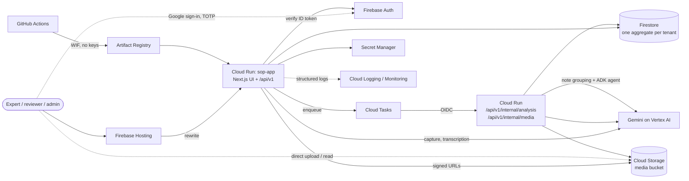
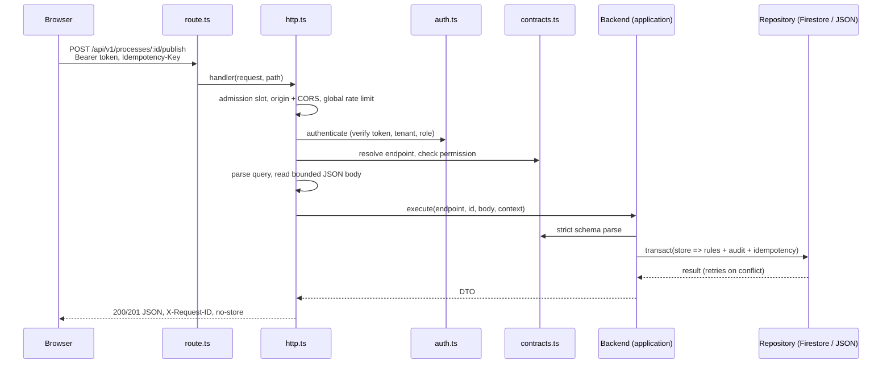
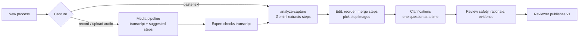
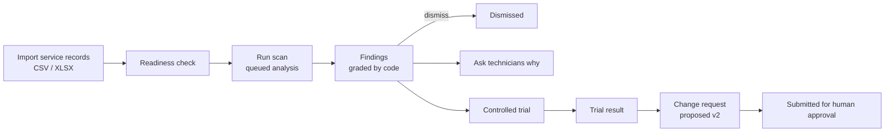
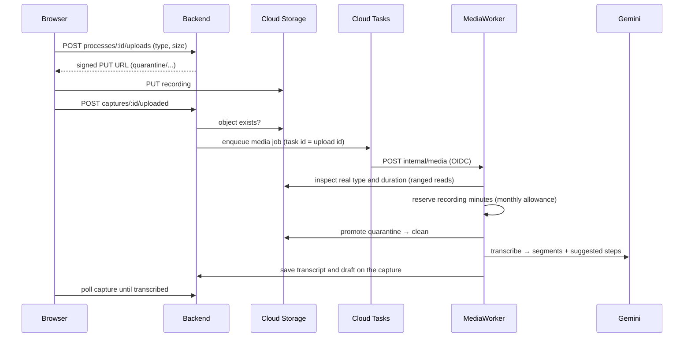

<p align="center">
  
</p>

# Sopify architecture

Sopify turns what experienced people know into a human-approved standard operating procedure (SOP), then looks for field practices that do better than that standard and checks them before anything changes. This document is the map of the whole system: what runs where, how a request travels through the code, how data is stored, and how the AI, media and analysis pipelines fit in. Deeper references are linked at the end.

> The product was previously called **Good Exception**. Environment variables (`GOOD_EXCEPTION_*`), Firebase app names, the Terraform `app_name` (`sop-app`) and the project ID keep the old names on purpose, so existing deployments and credentials keep working.

## Contents

1. [System at a glance](#1-system-at-a-glance)
2. [Repository layout](#2-repository-layout)
3. [Runtime modes](#3-runtime-modes)
4. [Frontend](#4-frontend)
5. [Backend layers](#5-backend-layers)
6. [Life of an API request](#6-life-of-an-api-request)
7. [Identity, tenancy and roles](#7-identity-tenancy-and-roles)
8. [Data model and storage](#8-data-model-and-storage)
9. [Core workflows](#9-core-workflows)
10. [Media pipeline](#10-media-pipeline)
11. [AI boundary](#11-ai-boundary)
12. [Scan analysis](#12-scan-analysis)
13. [Limits, safety and observability](#13-limits-safety-and-observability)
14. [Infrastructure and delivery](#14-infrastructure-and-delivery)
15. [Testing](#15-testing)
16. [Configuration reference](#16-configuration-reference)
17. [Further reading](#17-further-reading)

## 1. System at a glance

One Next.js application serves both the web UI and a versioned JSON API. In production it runs as a single Cloud Run service behind Firebase Hosting; everything stateful lives in managed Google Cloud services.



The worker endpoints are the same Cloud Run service; Cloud Tasks calls back into it so slow work (scan analysis, transcription) runs outside the user's request.

## 2. Repository layout

```text
src/
  app/                    Next.js App Router
    (workspace)/          Authenticated pages: overview, processes, captures, scans,
                          findings, trials, change requests
    api/[...path]/        Single catch-all route handler for the whole API
    layout.tsx, providers.tsx, globals.css, icon.svg, apple-icon.png
  components/
    ui/                   shadcn/ui primitives on Radix
    layout/               Shell: sidebar, topbar, mobile nav, logo
    common/               Shared presentational pieces
  features/               One folder per product area (capture, processes, scans,
                          findings, trials, changes, export, auth, overview)
  lib/
    client/               Browser-only: API client, React Query hooks, auth, uploads
    server/               Transport and security boundary: HTTP, auth, contracts,
                          config, limits, AI adapters, Cloud Tasks, runtime wiring
    application/          Use cases and workflow rules, ports, store, workers
      analysis/           Scan analysis: note grouping toolkit, statistics, worker
    domain/               Pure types and rules: processes, steps, findings, records
    infrastructure/       Adapters: Firestore, JSON file store, GCS, local media,
                          Firebase Admin, demo AI, backup
  instrumentation.ts      Process hooks (fatal-error logging, shutdown)
infra/                    Terraform for Google Cloud (+ billing-cap Cloud Function)
scripts/                  Dev launcher, deploy, seed, backup, OpenAPI, load test
tests/                    unit/, integration/ (Firebase emulators), e2e/ (Playwright)
evals/                    Live model evaluation cases
docs/                     Product, API, ADRs, operations, business documents
public/brand/             Sopify logo artwork (PNG master, SVG lockup and mark)
```

Dependencies point inwards: `server` → `application` → `domain`, and `infrastructure` implements interfaces declared in `application/ports.ts`. Domain code never imports HTTP, Firebase or Google SDKs.

## 3. Runtime modes

`src/lib/server/config.ts` validates the environment once and fails closed on anything inconsistent. `src/lib/server/runtime.ts` composes the backend for the selected mode.

| Mode                                  | How it starts                              | Identity                                             | Storage                                      | AI and media                                                                                                                   |
| ------------------------------------- | ------------------------------------------ | ---------------------------------------------------- | -------------------------------------------- | ------------------------------------------------------------------------------------------------------------------------------ |
| **Demo** (`GOOD_EXCEPTION_MODE=demo`) | Playwright suite, `next dev` with demo env | Fixed demo admin, loopback requests only             | JSON file in `.demo-data/` with file locking | Labelled sample extraction and transcript; media on local disk                                                                 |
| **Local live** (`npm run dev`)        | `scripts/dev-local.mjs`                    | Real Google sign-in                                  | Live Firestore                               | Live Gemini; uploads relayed through the dev server because personal credentials cannot sign bucket URLs; transcription inline |
| **Production**                        | Docker image on Cloud Run                  | Firebase ID tokens, custom-claim roles, optional MFA | Firestore                                    | Gemini on Vertex AI; signed GCS URLs; Cloud Tasks for analysis and media                                                       |
| **Emulator tests**                    | `npm run test:emulator`                    | Firebase Auth emulator                               | Firestore emulator                           | Not used                                                                                                                       |

Cloud Run refuses to start in demo mode, and production refuses to start without a project ID, a pseudonym key and allowed origins.

## 4. Frontend

- **Framework.** Next.js 16 App Router with React 19, built as a standalone server. Pages under `src/app/(workspace)` are thin; the work is in `src/features/*`.
- **Shell.** `(workspace)/layout.tsx` renders the sidebar (desktop), the mobile header and tab bar, the top bar and a global busy indicator. The Sopify mark and wordmark live in `src/components/layout/logo.tsx` as inline SVG, coloured by the `--logo-*` tokens in `globals.css`.
- **Styling.** Tailwind CSS 4 with every colour defined as a token in `globals.css`; components never use raw hex values. Primitives come from shadcn/ui on Radix.
- **Data.** TanStack React Query (`lib/client/queries.ts`) over a typed fetch client (`lib/client/api.ts`) that attaches the Firebase ID token and an `Idempotency-Key` on writes.
- **Auth.** `AuthGate` wraps the app in `providers.tsx`. It loads Firebase Auth lazily from Hosting's `/__/firebase/init.json`; when that config is missing (the loopback demo) sign-in stays off and the demo identity applies. Authenticator-app (TOTP) enrolment is supported for the second factor.
- **Forms.** React Hook Form with Zod schemas.
- **Recording and import.** Audio is recorded or uploaded in the browser (`features/capture`) and sent straight to storage through a signed URL. CSV/XLSX service records are parsed in the browser with SheetJS before upload as rows.
- **Export.** Published SOPs export to PDF (jsPDF) and PowerPoint (pptxgenjs) entirely client-side. `features/export/sop-document.ts` builds one format-neutral document model that both renderers consume, including step images.

## 5. Backend layers

| Layer          | Responsibility                                                                                                           | Main files                                                                                  |
| -------------- | ------------------------------------------------------------------------------------------------------------------------ | ------------------------------------------------------------------------------------------- |
| Route          | Single entry for every method; hides configuration failures behind a generic 503                                         | `src/app/api/[...path]/route.ts`                                                            |
| HTTP           | CORS and origin checks, health, internal task endpoints, body limits, deadlines, status codes, safe errors, request logs | `lib/server/http.ts`, `limits.ts`, `errors.ts`, `deadline.ts`                               |
| Contracts      | Endpoint table (method, path, permission), strict Zod request schemas, OpenAPI source                                    | `lib/server/contracts.ts`, `scripts/openapi.ts`                                             |
| Authorization  | Token verification, tenant and role extraction, permission checks, MFA for privileged roles                              | `lib/server/auth.ts`, `infrastructure/firebase.ts`                                          |
| Application    | Workflow rules, idempotency, audit events, quotas, short transactions                                                    | `application/backend.ts`, `process-service.ts`, `evidence-service.ts`, `evidence-engine.ts` |
| Store          | Tenant aggregate shape, schema migration, invariants, retention pruning, quotas                                          | `application/store.ts`                                                                      |
| Ports          | Interfaces for repositories, AI, media storage, signing, transcription, jobs                                             | `application/ports.ts`                                                                      |
| Workers        | Idempotent background jobs for scans and recordings                                                                      | `application/analysis/worker.ts`, `application/media-worker.ts`                             |
| Infrastructure | Firestore and JSON repositories, GCS and local media, demo adapters, backup                                              | `lib/infrastructure/*`                                                                      |
| AI adapters    | Gemini capture and transcription, ADK scan agent, guarded wrapper, usage metering                                        | `lib/server/ai.ts`, `gemini.ts`, `gemini-transcriber.ts`, `scan-agent.ts`, `ai-usage.ts`    |
| Runtime        | Builds the object graph for the current mode, exactly once per process                                                   | `lib/server/runtime.ts`, `hooks.ts`                                                         |

`Backend` receives its repositories, AI adapter, analysis queue and media ports through its constructor, so tests swap any of them without touching business logic.

## 6. Life of an API request



Every path is available under `/api/v1/...` and, for compatibility, under `/api/...`. Health endpoints (`/health/live`, `/health/ready`) and the internal task endpoints are handled before authentication; internal endpoints require a verified Cloud Tasks OIDC token (or, for loopback-only media routes, a locally signed grant). Permission checks happen before the body is read or any provider is called.

The endpoint groups are:

| Group           | Endpoints (under `/api/v1`)                                                                                                                 |
| --------------- | ------------------------------------------------------------------------------------------------------------------------------------------- |
| Workspace       | `GET workspace`                                                                                                                             |
| Processes       | list, create, get, update, delete, `purge`, `media`                                                                                         |
| Capture         | `captures` (create), `uploads`, `frames`, `captures/:id`, `uploaded`, `transcript`, `analyze-capture`, `clarifications`, `draft`, `publish` |
| Scans           | create, get, `readiness`, `run`, `findings`                                                                                                 |
| Findings        | list, get, `dismiss`, `restore`, `request-explanation`                                                                                      |
| Trials          | list, create, get, `results`                                                                                                                |
| Change requests | list, create, get, `submit`                                                                                                                 |
| Admin           | `audit-events`, `maintenance/retention`, `metrics`                                                                                          |
| Internal        | `internal/analysis`, `internal/media`, `internal/media-upload`, `internal/media-file`                                                       |

The full contract is generated into [`docs/openapi.json`](docs/openapi.json) and checked in CI (`npm run api:check`).

## 7. Identity, tenancy and roles

- **Authentication.** The browser signs in with Google through Firebase Auth and sends the ID token as a bearer token. The server verifies it with the Admin SDK, including revoked and disabled users, and rejects expired tokens or implausible `auth_time`.
- **Tenant.** The organization comes from a trusted custom claim (`scripts/set-claims.mjs`). When `GOOD_EXCEPTION_OPEN_ORGANIZATION` is set, users without a claim join that organization with `GOOD_EXCEPTION_OPEN_ROLE` (the current prototype setup). Identifiers are validated before they are used in any storage path, and every repository is obtained with `forTenant(organizationId)` before any lookup.
- **Roles and permissions.**

  | Permission | Granted to                                                                    | Used for                                           |
  | ---------- | ----------------------------------------------------------------------------- | -------------------------------------------------- |
  | `read`     | viewer, expert, reviewer, admin                                               | All GET endpoints                                  |
  | `write`    | expert, reviewer, admin                                                       | Captures, uploads, scans, explanations             |
  | `process`  | expert, reviewer, admin (everyone when `GOOD_EXCEPTION_ROLES_ENFORCED=false`) | Create, edit, delete processes                     |
  | `review`   | reviewer, admin                                                               | Publish, trials, change requests, dismiss findings |
  | `admin`    | admin                                                                         | Purge, audit log, retention, metrics               |

- **MFA.** With `GOOD_EXCEPTION_REQUIRE_MFA=true`, reviewer and admin actions require a second factor in the token.
- **Demo identity.** Accepted only in demo mode and only from a loopback host; production rejects it outright.

## 8. Data model and storage

### Domain

Defined in `src/lib/domain/types.ts`:

| Entity                            | Meaning                                                                                                                                                        |
| --------------------------------- | -------------------------------------------------------------------------------------------------------------------------------------------------------------- |
| `Process`                         | A procedure with immutable `ProcessVersion`s (`draft` or `published`), each a list of `ProcessStep`s with safety notes, rationale and optional images          |
| `ExpertCapture`                   | One capture of know-how: pasted text or an audio recording, with its transcript and suggested steps                                                            |
| `Clarification`                   | A follow-up question about a draft and the expert's answer                                                                                                     |
| `Scan`                            | A batch of imported service records (`Execution`s) checked for readiness and analysed                                                                          |
| `Finding`                         | A candidate practice that differs from the SOP, with evidence metadata, moving through `candidate → investigate → controlled_trial → validated` or `dismissed` |
| `ValidationTrial` / `TrialResult` | A controlled trial of a finding and its measured outcome                                                                                                       |
| `ChangeRequest`                   | A proposed next SOP version backed by a trial, `draft → submitted → approved`                                                                                  |
| `TechnicianResponse`              | An answer to "why do you do it this way?"                                                                                                                      |

Technician references in imported records are pseudonymized with an HMAC key from Secret Manager. Analytics compare practices, never people: there are no worker rankings anywhere in the model.

### Persistence

Each tenant's state is one versioned aggregate (`Store` in `application/store.ts`), holding every collection above plus idempotency records and quotas. Audit events live outside it, in `organizations/{id}/auditEvents`, written in the same transaction as the change they record.

- **Firestore** (production): a single document at `organizations/{organizationId}/backend/state`, read with one point lookup and updated in a transaction that retries conflicts. Firestore rules deny all direct browser access; only the server's Admin SDK reaches it.
- **JSON file** (demo and tests): the same aggregate in `.demo-data/store.json`, protected by a cross-process lease lock, revision numbers, fsync and atomic rename.

The aggregate is deliberately bounded: 750 KB serialized, 500 entries per collection, 1,000 idempotency records. Writes past a limit fail explicitly instead of discarding data. Retention: raw capture content and imported rows expire after 30 days, idempotency keys after 24 hours, audit events after 90 days (a Firestore TTL policy deletes them); `POST maintenance/retention` purges the rest. A failed scan keeps its rows for a day of retries, a finished one only the rows its findings show. Approved SOPs are kept. Growing past these limits means migrating to per-entity documents, as recorded in [ADR 001](docs/adr/001-backend-boundaries.md).

### Media objects

`application/media-paths.ts` is the only code that knows the bucket layout:

```text
quarantine/{org}/{process}/{upload}          uploaded, not yet inspected
quarantine/{org}/{process}/frames/{upload}   uploaded step images
clean/{org}/{process}/{upload}               inspected recordings
published/{org}/{process}/v{n}/{step}        images kept with a published version
```

## 9. Core workflows

### Create the first SOP



Publishing is a `review` permission and always a human action. Captures and clarifications never modify an already published version.

### Improve an existing SOP



A change request requires a validated trial, and the current SOP stays unchanged until the organization approves the new version. No step in either flow is approved automatically.

## 10. Media pipeline

Audio walkthroughs never pass through the API body. The browser uploads straight to storage, and a worker turns the file into a draft.



Every step is idempotent: a recording that is no longer `awaiting_upload` is skipped, storage moves tolerate having already run, and the final retry records the failure on the capture. In demo mode the same `MediaWorker` runs against local disk with a labelled sample transcriber; in local live mode it runs inline in the dev server.

## 11. AI boundary

- **Capture extraction** (`lib/server/gemini.ts`) turns text into structured steps and clarification questions with Gemini on Vertex AI. `GuardedCaptureAdapter` (`ai.ts`) bounds input size, output tokens and time, validates the output against a strict schema, and isolates failures.
- **Transcription** (`gemini-transcriber.ts`) produces timed segments and suggested steps that must fit the measured recording length.
- **Scan agent** (`scan-agent.ts`) groups job notes with Gemini and runs the Google Agent Development Kit agent.
- **Metering.** Every model call is wrapped by `ai-usage.ts` and logged as an `ai_usage` event (feature, model, tokens, latency), which Cloud Monitoring turns into metrics and a dashboard. Per-user and per-tenant hourly call quotas are enforced in the store.

Model output is always a candidate. It cannot publish an SOP, change permissions, write evidence or call anything beyond its declared tools. Extraction runs outside the database transaction, and the backend checks the draft has not changed before committing the result. There is no silent provider fallback and no automatic model retry; failures show as an unavailable state.

## 12. Scan analysis

A scan run enqueues a job (Cloud Tasks in production, inline otherwise) that `AnalysisWorker` processes within a 4-minute budget:

1. **Signals.** Each job becomes one line: its notes, checklist items not done, and parts that differ from what is usual for the equipment model (`analysis/toolkit.ts`). Checklists and parts every job shares are left out, because they made all jobs look alike. Outcomes and technician IDs are never sent to the model.
2. **Clusters.** Gemini sorts the distinct lines into groups that describe the same thing (structured JSON, 250 lines per call; larger scans are grouped in parts that are then joined). Code checks the answer: indexes in range, every line in exactly one group, nothing dropped. Groups need at least 3 jobs. Embedding similarity was tried first, but notes from one domain all scored above 0.9 against each other and negations ("suspended BitLocker" vs "without suspending BitLocker") scored as similar, so every scan collapsed into one group.
3. **Agent.** The ADK agent has exactly four tools: `get_sop`, `list_clusters`, `evaluate_practice` (statistics computed in code) and `propose_finding`. It proposes at most five findings, each of which a human reviews.
4. **Statistics in code.** `analysis/stats.ts` computes callback rates, compares jobs only with jobs by the same technician on the same equipment and job type, and holds out later jobs as a check. _Promising_ needs 10 jobs, 2 technicians and a 10% reduction; _strong_ needs 30 jobs, 3 technicians, 20% and a significant held-out result. The model never computes a number that is shown as evidence.
5. **Funnel.** The scan records how many jobs survived each stage (reviewed → recurring → enough examples → fewer callbacks → held on later jobs), which the results page shows.

Re-delivered jobs are harmless: a scan that is no longer `analyzing` is left alone.

## 13. Limits, safety and observability

- **Admission control** (`limits.ts`): 32 active and 64 waiting requests per instance, 120 requests per user per minute and a global rate. The process drains on shutdown and `/health/ready` turns 503.
- **Quotas** (stored with the tenant): 40 writes per user per minute, 20 AI calls per user per hour (five times that per tenant), and a monthly allowance of recording minutes.
- **Input bounds**: 1 MB bodies with depth and node limits, 1,000 imported rows, 100 steps, 20,000 capture characters, 15 s request deadline (longer for AI capture), 800 KB responses.
- **Idempotency**: write requests carry an `Idempotency-Key`, scoped to actor and tenant and checked inside the transaction.
- **Audit**: every state change appends an audit event, readable by admins.
- **Headers**: strict CSP, HSTS in production, `nosniff`, `no-referrer`, `X-Frame-Options: DENY`, restricted Permissions-Policy (`next.config.ts`).
- **Errors**: `errors.ts` maps every failure to a safe body with a code and request ID; secrets, stack traces and infrastructure names are never returned.
- **Logs**: one structured JSON line per request (route, status, duration, actor, tenant, code) and per AI call, consumed by log-based metrics in `infra/monitoring.tf`. Admins can read in-process counters from `GET metrics`.

## 14. Infrastructure and delivery

Terraform in [`infra/`](infra/README.md) defines the production project (region `asia-northeast1`):

| Resource                                     | Purpose                                                                |
| -------------------------------------------- | ---------------------------------------------------------------------- |
| Cloud Run v2 (`run.tf`)                      | The app; scales to zero, request-only CPU                              |
| Artifact Registry                            | Container images, last ten kept                                        |
| Firestore                                    | Tenant aggregates; rules and indexes deployed by the Firebase CLI      |
| Cloud Storage (`media.tf`)                   | Media bucket; quarantine and clean objects are deleted after 30 days   |
| Cloud Tasks (`tasks.tf`)                     | Shared queue for analysis and media: 2 concurrent, 3 attempts          |
| Vertex AI                                    | Gemini models, accessed by the runtime service account                 |
| Secret Manager                               | Pseudonym HMAC key                                                     |
| IAM + Workload Identity Federation (`ci.tf`) | Dedicated least-privilege service accounts; keyless GitHub Actions     |
| Monitoring (`monitoring.tf`)                 | Log-based AI and request metrics, dashboard                            |
| Billing (`budget.tf`, `billing-cap.tf`)      | Budget alerts and an optional, dry-run-by-default billing cap function |

Delivery:

1. **`Backend verification`** workflow on every push: format, lint, OpenAPI check, typecheck, unit tests, dependency audit, build, Playwright end-to-end tests, emulator tests, load test and a Docker build.
2. **`Deploy`** workflow, after verification succeeds on `main` (opt-in via `DEPLOY_ENABLED`): build the image, scan it with Trivy, push by digest, stage a no-traffic `candidate` revision, probe its health, then promote. `scripts/deploy.sh` does the same from a workstation.
3. **`Infrastructure`** workflow validates and tests Terraform with mocked providers; **`Model eval`** runs live model evaluations on demand.

The Docker image is a multi-stage build on `node:24-bookworm-slim` that runs the Next.js standalone server as the non-root `node` user.

## 15. Testing

| Level       | Command                                                                          | What it covers                                                                                                                |
| ----------- | -------------------------------------------------------------------------------- | ----------------------------------------------------------------------------------------------------------------------------- |
| Unit        | `npm test`                                                                       | Domain rules, statistics, schemas, HTTP handler, workers, exports, UI components (Node test runner + Testing Library + jsdom) |
| Integration | `npm run test:emulator`                                                          | Real Firebase Admin SDK against Auth and Firestore emulators: token checks, tenant isolation, deny-all rules                  |
| End to end  | `npm run test:e2e`                                                               | Both product flows in Chromium, desktop and mobile, against a throwaway demo store on port 3100                               |
| Model eval  | `npm run eval`                                                                   | Extraction and scan quality against live Gemini                                                                               |
| Load        | `npm run test:load`                                                              | Bounded local load against the handler                                                                                        |
| Infra       | `terraform -chdir=infra test`                                                    | Safe defaults and IAM boundaries with mocked providers                                                                        |
| Static      | `npm run typecheck`, `npm run lint`, `npm run format:check`, `npm run api:check` | Types, lint, formatting, API contract drift                                                                                   |

Tests use temporary data directories and never touch demo or live data.

## 16. Configuration reference

All settings are validated in `src/lib/server/config.ts`.

| Variable                                                                                  | Purpose                                                           |
| ----------------------------------------------------------------------------------------- | ----------------------------------------------------------------- |
| `GOOD_EXCEPTION_MODE`                                                                     | `demo` (default) or `production`                                  |
| `GOOGLE_CLOUD_PROJECT`                                                                    | Firebase / Google Cloud project                                   |
| `GOOD_EXCEPTION_ALLOWED_ORIGINS`                                                          | Comma-separated origins allowed to call the API                   |
| `GOOD_EXCEPTION_PSEUDONYM_KEY`                                                            | HMAC key for technician pseudonyms (Secret Manager)               |
| `GOOD_EXCEPTION_REQUIRE_MFA`                                                              | Require a second factor for reviewer and admin actions            |
| `GOOD_EXCEPTION_ROLES_ENFORCED`                                                           | When `false`, any role may manage processes                       |
| `GOOD_EXCEPTION_OPEN_ORGANIZATION`, `GOOD_EXCEPTION_OPEN_ROLE`                            | Organization and role for users without claims                    |
| `GOOD_EXCEPTION_GEMINI_MODEL`, `GOOD_EXCEPTION_AGENT_MODEL`                               | Vertex AI models; AI is off when the main model is unset          |
| `GOOD_EXCEPTION_TASKS_QUEUE`, `GOOD_EXCEPTION_WORKER_URL`, `GOOD_EXCEPTION_TASKS_INVOKER` | Cloud Tasks queue, worker URL and OIDC invoker; all three or none |
| `GOOD_EXCEPTION_MEDIA_BUCKET`                                                             | Bucket for recordings and step images                             |
| `GOOD_EXCEPTION_LOCAL`                                                                    | Local live mode: relay media through the dev server               |
| `GOOD_EXCEPTION_DATA_DIR`                                                                 | Demo JSON store location                                          |

## 17. Further reading

- [README](README.md): local setup and day-to-day commands
- [API details](docs/API.md) and [OpenAPI](docs/openapi.json)
- [ADR 001: backend boundaries and bounded tenant aggregates](docs/adr/001-backend-boundaries.md)
- [Backend architecture notes](docs/product/architecture.md) and [technology list](docs/tech-stack.md)
- [Video SOP pipeline](docs/product/video-sop-pipeline.md) and [Google Cloud plan](docs/product/gcp-plan.md)
- [Operations runbook](docs/operations/runbook.md) and [threat model](docs/operations/threat-model.md)
- [Infrastructure](infra/README.md)
