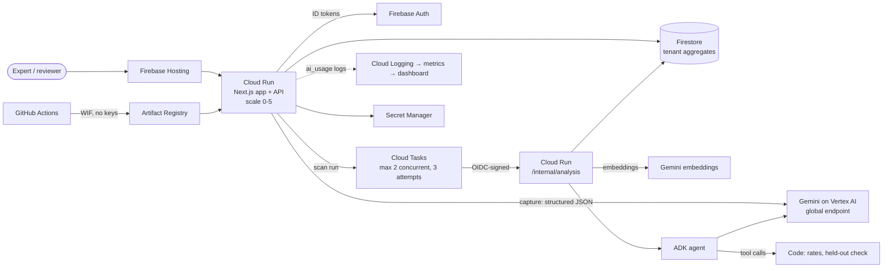

# Good Exception backend architecture

Good Exception captures expert know-how into a human-approved SOP and investigates candidate practices through controlled validation. It analyzes practices, never worker rankings. The complete illustrative demo remains available locally. The backend has verified Firebase identity and Firestore adapters, tested with isolated emulators, plus Gemini (Vertex AI) capture and an ADK scan agent. The Google Cloud stack is defined in Terraform but has not been applied to a live project yet.

## Boundaries

| Layer | Responsibility | Main files |
| --- | --- | --- |
| UI | Responsive process, finding and trial workflows | `components/workspace.tsx` |
| HTTP | Bounded request parsing, CORS, identity, safe errors, response codes | `src/lib/server/http.ts`, `contracts.ts` |
| Authorization | Verified organization/role, resource scope, reviewer/admin MFA | `src/lib/server/auth.ts` |
| Application | Workflow invariants, idempotency, short transactions, audit events | `src/lib/application/backend.ts`, `process-service.ts`, `evidence-service.ts` |
| Domain | Structured SOP versions, evidence, trials, proposals | `src/lib/domain/types.ts`, `src/lib/application/store.ts` |
| Repository port | Tenant-scoped atomic reads and writes | `src/lib/application/ports.ts` |
| Local infrastructure | Lease locking, fsync, atomic rename, backup/restore | `src/lib/infrastructure/json-repository.ts`, `backup.ts` |
| Cloud infrastructure | Firebase revoked-token verification and Firestore transactions | `src/lib/infrastructure/firebase.ts`, `firestore-repository.ts` |
| AI boundary | Input/output limits, strict candidate schema, failure isolation, usage metering | `src/lib/server/ai.ts`, `gemini.ts`, `ai-usage.ts` |
| Scan analysis | Embedding clusters, ADK agent tools, code-computed statistics, idempotent background worker | `src/lib/application/analysis/`, `src/lib/server/scan-agent.ts`, `cloud-tasks.ts` |
| Runtime | Dependency composition, admission, health, logs and shutdown | `src/lib/server/runtime.ts`, `hooks.ts` |

Configuration comes from validated environment names; secrets are never returned, logged or included in drafts. Local demo identities are accepted only for loopback requests. Production fails closed unless Firebase/project, allowed origins and HMAC configuration exist, and Cloud Run refuses demo/emulator mode. Production Firebase authentication is backend-only at present: the UI still uses the demo flow and needs a separate sign-in integration before public use.

## Storage and lifecycle

The repository is scoped before any object lookup. Firestore uses one transactionally updated, versioned aggregate document per tenant; direct browser access is denied. The foundation explicitly caps serialized state at 750 KB, domain collections at 500 entries and retained audit entries at 1,000. It is not a warehouse-scale design. The [storage ADR](../adr/001-backend-boundaries.md) explains the capacity envelope, migration and eventual per-entity/BigQuery boundary.

Schema v2 migrates the old local JSON format without replacing current SOPs. Mutations enforce parent references, unique trial/finding and change/trial relations, valid published versions and organization consistency. Idempotency keys are scoped to actor/tenant and checked inside the transaction. Capture extraction runs outside the transaction; its draft fingerprint is checked before commit. Model output never publishes an SOP, changes privileges or computes outcome evidence. The scan agent's only tools read the SOP and note clusters, request a code-computed evaluation, and propose a candidate finding that a human reviews.

Raw capture content and imported rows have 30-day expiration; the retention endpoint purges expired raw content, while approved SOPs remain authoritative knowledge. Request keys expire after 24 hours and audit events after 90 days. Production scheduling, backup retention and a real restore drill remain external launch prerequisites. Local backup recovery is automated in tests.

## Current versus future integrations

- **Implemented and emulator-tested:** Firebase Admin token verification including disabled/revoked users, trusted custom-claim roles, Firestore transactions, tenant isolation and deny-all client rules.
- **Implemented locally:** both labeled demo product loops, import readiness, HMAC pseudonymization in configured mode, strict schemas, read/write limits, audit events, safe errors, health and diagnostic metrics, backup/restore, OpenAPI, CI and bounded load checks.
- **Implemented, unit-tested, not yet run against a live project:** Gemini capture on Vertex AI, the ADK scan agent with Gemini embeddings, Cloud Tasks background analysis with OIDC-verified worker calls, AI usage metrics, and the Terraform stack. Live quality is measured by `npm run eval` (manual `Model eval` workflow).
- **Implemented in the local demo:** audio upload through locally signed URLs, filesystem media storage, inspection, a labelled sample transcriber and the transcript check screen. The Cloud Storage signer and adapter and a speech-to-text transcriber are not built, so production returns 503 for uploads.
- **Explicitly unavailable:** video and document ingestion, BigQuery evidence computation, technician messaging, field-trial allocation/ingestion, cross-scan vector search and final organizational approval of v2. Production never substitutes sample evidence for these integrations.
- **Not deployed or claimed:** a running Cloud Run/Firebase Hosting environment, live IAM/KMS/TLS validation, automated cloud backups, retention scheduling, Cloud Monitoring alert delivery, autoscaling validation, a production sign-in UI or legal/provider data-processing approval.

## Google Cloud deployment

Defined in [`infra/`](../../infra/) (Terraform, `asia-northeast1`) and deployed by GitHub Actions through Workload Identity Federation.

Efficiency choices: Cloud Run scales to zero with request-only CPU; Flash is the default model and every call is metered by feature; heavy analysis is queued so request latency stays flat and concurrent model spend is capped; Artifact Registry keeps ten images; a budget alert covers the project. Not used on purpose: Kubernetes, Pub/Sub, BigQuery and vector databases, until data volume needs them.

See the [API contract](../API.md), [complete checklist assessment](../backend-checklist.md), [operations runbook](../operations/runbook.md), and [threat model](../operations/threat-model.md).
